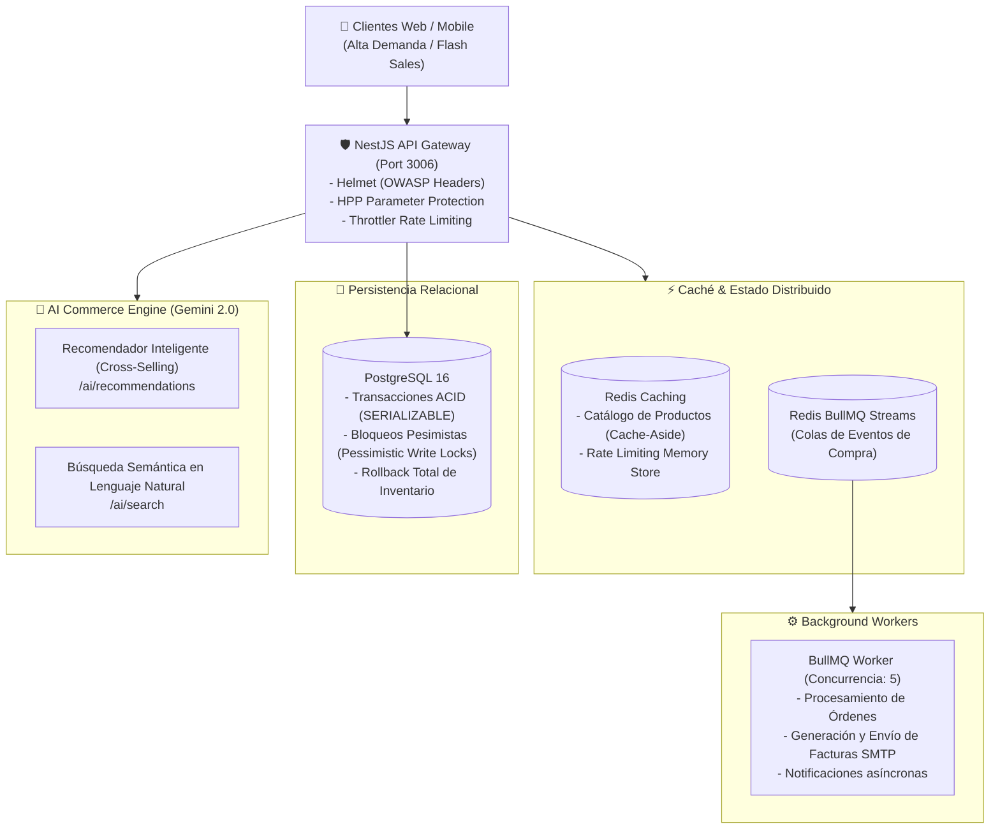

# 🛒 E-Commerce Enterprise API & AI Commerce Engine

[](https://www.typescriptlang.org/)
[](https://nestjs.com/)
[](https://www.postgresql.org/)
[](https://redis.io/)
[](https://bullmq.io/)
[](https://ai.google.dev/)
[](http://localhost:3006/docs)
[](https://www.docker.com/)

Plataforma backend de comercio electrónico de grado empresarial construida con **NestJS**, diseñada para alta concurrencia en eventos de ventas masivas (*Flash Sales / Black Friday*), con **transacciones ACID y bloqueos pesimistas para impedir sobreventa de inventario (*over-selling*)**, **estrategia de caché con Redis**, **procesamiento asíncrono mediante BullMQ**, y un **motor de Inteligencia Artificial impulsado por Google Gemini**.

---

## 🏛️ Arquitectura del Sistema



---

## ⚡ Retos de Ingeniería y Soluciones Implementadas

### 1. 🛡️ Prevención de Sobreventa de Inventario (Anti-OverSelling & Race Conditions)
- **El Problema:** Cuando miles de compradores intentan adquirir simultáneamente la última unidad de un producto con alta demanda, las lecturas concurrentes sin control provocan sobreventa y stock negativo.
- **La Solución:** Implementación de transacciones con `QueryRunner` en nivel de aislamiento `SERIALIZABLE` y **Bloqueo Pesimista de Escritura (`pessimistic_write` / `SELECT ... FOR UPDATE`)**. Si una orden compuesta por múltiples artículos se queda sin stock en uno de ellos, el sistema ejecuta un **rollback integral**, garantizando que ningún producto quede descontado indebidamente.

### 2. ⚡ Catálogo de Alto Rendimiento con Redis (Cache-Aside Pattern)
- En plataformas de e-commerce, más del **90% de las peticiones son lecturas** del catálogo (`GET /products`, `GET /categories`).
- Se implementó la estrategia **Cache-Aside**: las consultas leen desde memoria en Redis con TTL de 3 a 5 minutos, y la caché se invalida automáticamente (`deleteCache('products:*')`) ante cualquier mutación de inventario o creación de producto.

### 3. ⚙️ Desacoplamiento de Checkout con Colas Asíncronas (BullMQ)
- El proceso de confirmación de compra despacha tareas a la cola `orderQueue`.
- El endpoint de compra responde inmediatamente (`HTTP 201`) al usuario, mientras que el worker en segundo plano se encarga de la generación de comprobantes y envíos de correo por SMTP sin bloquear el hilo principal.

### 4. 🧠 Inteligencia Artificial con Google Gemini (`/ai`)
- **`POST /ai/recommendations`:** Analiza los productos presentes en el carrito y sugiere los 3 artículos complementarios más relevantes (*Cross-Selling*) con justificación de compra.
- **`POST /ai/search`:** Permite al usuario buscar productos mediante lenguaje coloquial (ej: *"auriculares bluetooth para salir a correr con cancelación de ruido"*), deduciendo la categoría y filtrando el catálogo semánticamente.

### 5. 🔒 Ciberseguridad y DevSecOps Silencioso
- **Protección Perimetral:** Cabeceras de seguridad con `Helmet`, protección contra contaminación de parámetros con `hpp` y limitación de tasa con `@nestjs/throttler`.
- **Protección de Datos:** Las credenciales y claves privadas de Cloudinary y base de datos se desacoplaron a `.env.example` protegidas por `.gitignore`.
- **DevSecOps Silencioso:** Pipeline en GitHub Actions (`security.yml`) que audita vulnerabilidades con `CodeQL` y `npm audit` **sin enviar correos ni generar alertas ruidosas**.

---

## 🚀 Despliegue Rápido con Docker Compose

Levanta PostgreSQL 16, Redis 7 y la API NestJS con un solo comando:

```bash
docker compose up --build -d
```

Verificar servicios activos:
```bash
docker compose ps
```

Acceder a la documentación interactiva:
```bash
http://localhost:3006/docs
```

---

## 🛠️ Instalación Local para Desarrollo

### 1. Clonar el repositorio
```bash
git clone https://github.com/mauro8778/E-commerce.git
cd E-commerce/back
```

### 2. Variables de entorno
```bash
cp .env.example .env
```

### 3. Iniciar dependencias auxiliares (PostgreSQL + Redis)
```bash
cd ..
docker compose up -d postgres redis
cd back
```

### 4. Instalar y correr en desarrollo
```bash
npm install
npm run start:dev
```

### 5. Compilar para producción
```bash
npm run build
npm run start:prod
```

---

## 🧪 Prueba de Concurrencia (Stress Test)

Ejecuta el script de concurrencia que simula 20 solicitudes simultáneas de compra:

```bash
npm run benchmark
```

**Resultado:**
- 🟢 **1 orden confirmada exitosamente (HTTP 201)**
- 🛡️ **19 intentos rechazados por falta de stock (HTTP 400)**
- ⏱️ Cero sobreventa y cero inconsistencia en la base de datos.

---

## 📡 Módulos y Endpoints Principales

### 🔐 Autenticación & Usuarios
- `POST /auth/signup` - Registro de usuario
- `POST /auth/signin` - Login y emisión de token JWT
- `GET /users` - Listado paginado de usuarios (Protegido por Bearer JWT)

### 📦 Catálogo de Productos
- `GET /products` - Listado optimizado con caché Redis
- `GET /products/:id` - Detalle de producto
- `POST /products` - Creación de producto (invalida caché)
- `POST /files/uploadImage/:id` - Carga de imágenes a Cloudinary

### 🛒 Órdenes & Checkout (ACID)
- `POST /orders` - Creación atómica de orden con bloqueo pesimista
- `GET /orders/:id` - Consulta de orden y detalle de facturación

### 🧠 Inteligencia Artificial (AI Commerce)
- `POST /ai/recommendations` - Sugerencias de compra cruzada con Gemini
- `POST /ai/search` - Búsqueda semántica en lenguaje natural

---

## 👨‍💻 Autor

Desarrollado por **Mauro Diaz**  
- **GitHub:** [@mauro8778](https://github.com/mauro8778)
- **LinkedIn:** [Mauro Diaz](https://www.linkedin.com/in/mauro-diaz-dev/)
